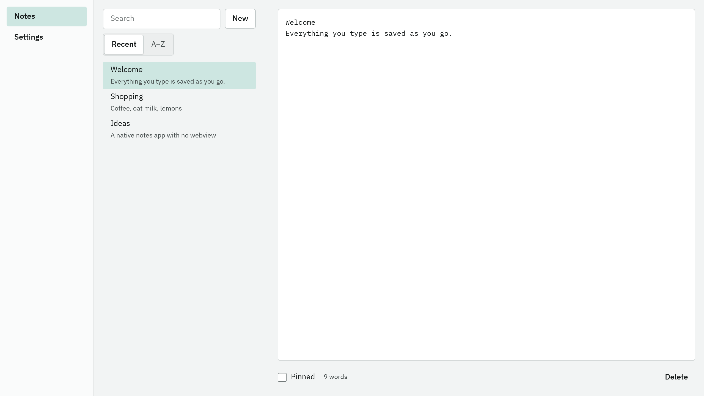

<p align="center">
  <picture>
    <source media="(prefers-color-scheme: dark)" srcset="assets/logo/alloy-lockup-dark.svg">
    
  </picture>
</p>

# Alloy

**A native Rust desktop UI framework where an app is a state struct and a view function.** Every pixel is drawn by Alloy's own GPU renderer. No webview, no HTML, CSS or JavaScript, and no existing GUI toolkit underneath. Tauri-sized binaries and idle behaviour, an iced-style typed architecture, and a lot less code to write.

```rust
use alloy_ui::prelude::*;

fn main() {
    sketch(0i64, |n| {
        col![
            heading("Counter"),
            text(format!("{n} so far")).dim(),
            row![
                button("Subtract").act(|n| *n -= 1),
                button("Add").primary().act(|n| *n += 1),
            ],
        ]
        .gap(14.0)
        .pad(24.0)
    })
    .run("Counter")
}
```

No message enum, no `update` function, no ids, no wrapper types. Handlers are closures over your state, and every widget is a plain function.



*The notes app above (searchable list, editor, pin, delete with confirmation, autosave, settings page, undo, command palette) is 26 lines in `crates/alloy/examples/notes.rs`.*

## How much less code, honestly

We wrote the same apps in idiomatic iced 0.14 (compiled, never a dependency) and in Alloy, and counted non-blank, non-comment lines after `cargo fmt` (`python3 crates/alloy/loc/count.py`).

| kind of app | example | iced | Alloy | fewer lines |
|---|---|---|---|---|
| everyday apps | pomodoro | 150 | 66 | 2.3x |
| | files | 222 | 69 | 3.2x |
| | wizard | 238 | 73 | 3.3x |
| | split | 100 | 47 | 2.1x |
| | **these four together** | 710 | 255 | **2.8x** |
| apps built from Alloy's ready-made blocks | admin (CRUD with `derive(Record)`) | 338 | 27 | 12.5x |
| | status board (async, table, chart) | 267 | 30 | 8.9x |
| | notes | 377 | 26 | 14.5x |

Read this as: **about 2.9x fewer lines on everyday apps, 9 to 14x when the app is mostly a table, a form or a list that a block already covers.** It is not a flat 10x. What is left in an ordinary app is your own logic, which no framework removes. The method, the iced sources and the audit of our own claims are in [BENCHMARKS.md](BENCHMARKS.md).

## Features

* **Concise or Elm, your choice.** `sketch(state, view)` with closures, or the `App` trait with a `Msg` enum, background `Cmd`s and subscriptions. Both are fully typed.
* **Batteries in the box.** Text, buttons, inputs, editor, sliders, pickers, date picker, sortable tables, lists, charts, wizards, `derive(Record)` CRUD screens, and a sidebar shell.
* **Forms that behave.** Validation messages wait until a field is touched or a submit fails.
* **Async without ceremony.** `resource(fetch)` gives loading, error with Retry, refresh and auto-refresh.
* **Finished-app details.** Shortcuts, a `mod+k` command palette, toasts with Undo, undo and redo, persisted state, multi-window.
* **Looks designed.** One teal-green accent, cool neutrals, small radii, WCAG AA contrast, light and dark following the system. See [DESIGN.md](DESIGN.md).
* **Small and quiet.** Counter binary 7.5 MB (`.deb` and `.rpm` 3.2 MB), 0% CPU when idle, first paint 87 to 106 ms under Xvfb (Linux, measured; see BENCHMARKS.md).
* **Speaks your users' language.** `t!("items", n = 3)` with plain-text catalogs, CLDR plurals, live language switching and right-to-left layouts that mirror on their own. See the [localization guide](docs/guide/13-localization.md).
* **Errors that explain themselves.** `state!`, `at!` and `derive(Record)` mistakes are reported on the exact token, with a suggestion.
* **Accessible.** An accessibility tree with AT-SPI on Linux.
* **Tauri-style shell.** `alloy` CLI to create, run and bundle (`.app`, `.dmg`, `.deb`, `.rpm`, AppImage, `.exe`, NSIS, MSI) and a capability file that denies everything not declared.
* **Testable.** A built-in headless `Harness` clicks, types and renders PNGs, and golden-image tests run without a window.

## Platform status

| platform | status |
|---|---|
| Linux (X11, Wayland) | built, tested and run locally: tests, headless rendering, bundling, AT-SPI |
| Windows | CI passed fmt, build, clippy and tests once; not yet run as an app |
| macOS | code compiles; CI has not run it yet, so treat it as unverified |

GitHub Actions is currently blocked by an account billing issue, so the Ubuntu and macOS matrix jobs have not completed. We only call something verified when a run has actually passed.

## Install

Alloy is not on crates.io yet. Use the git repository:

```sh
cargo install --git https://github.com/adswill/alloy-ui alloy-ui-cli   # the `alloy` tool
alloy new hello --identifier com.example.hello   # or --template dashboard | editor | settings | localized
cd hello && alloy dev
```

or add it to an existing project:

```toml
[dependencies]
alloy-ui = { git = "https://github.com/adswill/alloy-ui" }
```

Linux needs the usual GPU and windowing libraries (Vulkan or GL, X11 or Wayland). Then follow the [guide](docs/guide/README.md).

## Crates

| crate | what it is |
|---|---|
| `alloy-ui` | the facade: prelude, concise app API, shell wiring (start here) |
| `alloy-ui-core` | geometry, `Widget`/`Element`, events, draw commands, runtime loop, multi-window |
| `alloy-ui-layout` | flexbox-style layout engine (Fill/Shrink/Fixed, padding, spacing, alignment) |
| `alloy-ui-render` | wgpu renderer, CPU reference rasteriser, text (bundled IBM Plex), golden-image harness |
| `alloy-ui-theme` | light/dark palettes, type scale, spacing, motion (WCAG AA tested) |
| `alloy-ui-widgets` | text, button, inputs, editor, table, list, charts, overlays, focus, accessibility tree |
| `alloy-ui-platform` | windows, menus, tray, dialogs, clipboard, drag and drop, system theme, IME, screen readers |
| `alloy-ui-ipc` | typed background tasks and the capability/permissions config |
| `alloy-ui-macros` | `#[derive(Record)]` |
| `alloy-ui-cli` | `alloy` build and bundle tool (.app, AppImage/.deb/.rpm, .exe/.msi) |

## Docs

* [Cookbook](docs/cookbook/README.md): 30 short recipes, each compiled as a doc-test. The [website](website/README.md) and the [VS Code extension](editors/vscode/README.md) (snippets and `.alloy` syntax) live in this repository too.
* [Guide](docs/guide/README.md): getting started, state and bindings, layout, widgets, forms, async, multi-window, shortcuts and undo, theming, bundling, capabilities. Every snippet is compiled as a doc-test.
* [ARCHITECTURE.md](ARCHITECTURE.md) (design, and what we learned from iced and Tauri), [DECISIONS.md](DECISIONS.md) (every design choice with reasons), [DESIGN.md](DESIGN.md) (visual rules), [BENCHMARKS.md](BENCHMARKS.md) (measured numbers), [docs/WHY_ALLOY.md](docs/WHY_ALLOY.md).

Licensed under MIT OR Apache-2.0.
